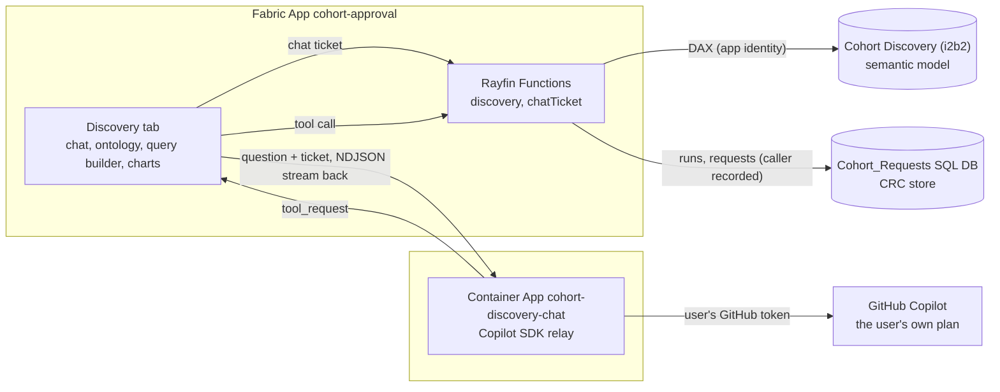
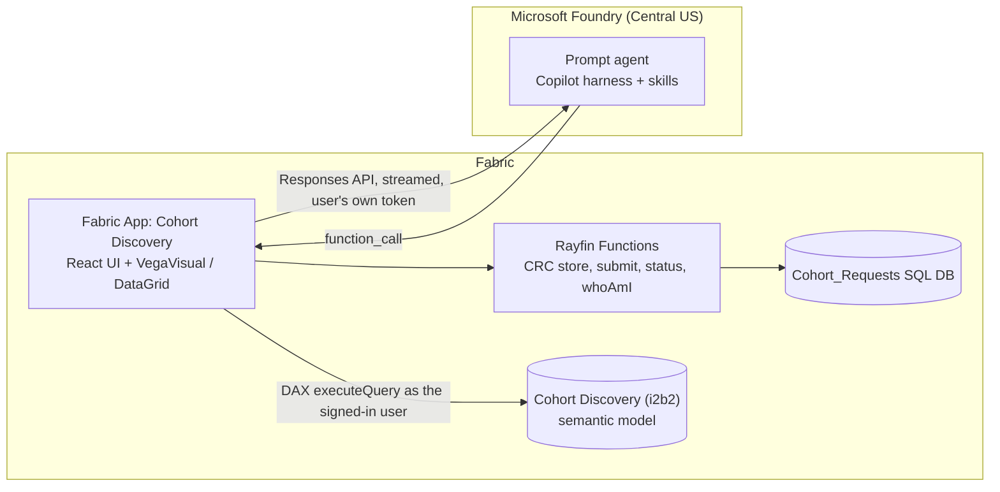
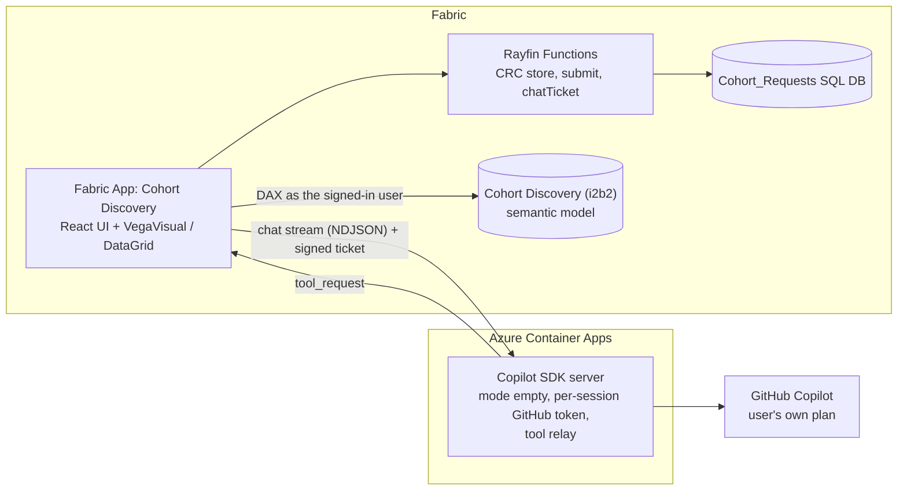

# Cohort Discovery hosted in Fabric: research and plan

Status: Option C is built and running in Fabric (2026-11-07). The Discovery tab of the approval app chats with GitHub
Copilot on each user's own Copilot plan and runs the i2b2 tools in the app's Rayfin Functions. Research done
2026-11-06.

Open it at https://<approval app host>/#/discovery (the Fabric capacity
must be running).

This is the design and build log of the original deployment. Names in angle brackets stand for your own deployment's:
the Azure names come from the `DISCOVERY_*` settings, and the addresses are printed by the setup scripts. To set the tab
up, follow [setup.md](setup.md), section 8.

## Decision (user, 2026-11-07)

- Build **Option C**: the Copilot SDK runs in an Azure Container App, and each user signs in with GitHub inside the
  app, so every question is billed to their own Copilot plan. The Foundry options (A and B) stay documented below.
- The chat is a new **Discovery tab in the approval app** (`cohort-approval`), so there is one Fabric App.
- Azure resources go in the resource group **<resource group>**.
- The GitHub OAuth App is owned by a personal GitHub account.
- The **local app stays** as it is ([apps/discovery/app.py](../apps/discovery/app.py), run with
  `.venv/bin/python apps/discovery/app.py`), so the whole process can still run locally.

## How it works (as built)

1. The tab asks the `chatTicket` function for a ticket: the caller's Entra object ID and UPN, valid 30 minutes, signed
   (HMAC-SHA256) with the Rayfin secret `CHAT_TICKET_KEY`. The relay holds the same key and checks the ticket on every
   call, so it knows which Fabric user owns each chat.
2. **Sign in with GitHub** opens a popup to the relay, which runs the GitHub OAuth web flow. The token stays in the
   relay's memory, keyed to the Fabric user, and never reaches the browser. Each chat session gets it through the SDK's
   `github_token_provider`, so every question uses that user's Copilot plan and their org's model policy.
3. The relay runs the Copilot SDK with `mode="empty"` (no shell or file tools) and the tool definitions exported from
   the local app (`apps/discovery/relay/tools.json`). When Copilot calls a tool, the relay sends a `tool_request`
   event down the stream. The page runs it through the `discovery` function and posts the result to
   `/api/tool-result`. The relay itself has no access to Fabric.
4. The `discovery` function runs the tool server-side. It compiles the i2b2 query to DAX (a TypeScript port of
   `i2b2_query.py`), runs it on the semantic model through the Power BI `executeQueries` API with the app's Fabric
   token, obfuscates the counts, and records runs and requests in the CRC store with the caller's UPN. Real counts
   never leave the function.
5. `show_visual` is an extra tool: Copilot sends a Vega-Lite spec built from counts it already has, and the page draws
   it with vega-embed in the app's theme. Keys that could load data or open links (`url`, `href`, `usermeta`) are
   dropped first.

What changed from the plan below, and why:

- **No semantic model connector.** A deployed function's `ctx.Tokens.Fabric` can call `executeQueries` (tested: HTTP
  200, 3,539 patients), so DAX runs in the function. With the delegated connector, real counts would have reached the
  browser before obfuscation (open item 7 below). The trade-off is that DAX runs with the app's identity (the item
  owner) rather than each user's, so anyone who can open the Fabric app can run counts. Copilot still runs as each
  user, which was the requirement. Users don't need Build permission on the semantic model.
- **One `discovery` function** dispatches every tool (`search_ontology`, `browse_ontology`, `list_modifiers`,
  `preview_query`, `run_i2b2_query`, `list_queries`, `get_query`, `submit_request`, `request_status`,
  `describe_model`, `explore_dax`) and the page's `query_detail` (opening a query from the history), instead of one
  function per action.
- **The registry uses its admin credential.** Pulling with a managed identity needs an AcrPull role assignment, which
  this account can't create (AuthorizationFailed).

## Build plan (Option C), in order

### Phase 1: Azure and GitHub setup (DONE 2026-11-07)

1. ✅ Container Apps environment in Central US (next to the Fabric capacity) with no log destination.
2. ✅ Container App with external ingress, 0 to 1 replicas; this gives the app its address.
3. ✅ GitHub OAuth App with the callback `https://<container address>/auth/github/callback`.
4. ✅ Container App secrets (GitHub client secret, chat ticket key), the GitHub client ID as a setting, and CORS limited
   to the approval app's address.

### Phase 2: chat relay (DONE 2026-11-07)

5. ✅ [apps/discovery/relay/server.py](../apps/discovery/relay/server.py): a Starlette server based on `app.py`, with
   chat tickets, the GitHub sign-in popup, the tool relay, `/api/me`, `/api/models`, `/api/chat`, `/api/stop`,
   `/healthz`, a keep-alive ping every 15 seconds, a 5 minute tool timeout and chats closed after 45 idle minutes.
6. ✅ `scripts/23_discovery_chat.py export` writes the tool definitions and rules from `app.py` and `cohort_mcp.py`
   (plus `show_visual`) to `tools.json`, so the image doesn't import the Fabric code.
7. ✅ Dockerfile; tested on this Mac with `23_discovery_chat.py local` (port 8770) and a test client that ran the
   tools locally: sign-in, the model list (Opus 5.5 with xhigh and max) and a full question.
8. ✅ Container registry `<registry>` (Basic); `23_discovery_chat.py deploy` builds the image in Azure, rolls
   the Container App and waits for `/healthz`.

### Phase 3: Discovery tab in the approval app (DONE 2026-11-07)

9. ✅ The i2b2 query layer in TypeScript:
   [i2b2.ts](../apps/approval/rayfin/functions/src/i2b2.ts) (ontology, query definition, DAX compiler, i2b2 XML,
   summary, obfuscation). `23_discovery_chat.py check` compiles every query in the CRC history with both compilers:
   the DAX, XML and summaries match for all 25.
10. ✅ The data side in the functions ([discovery.ts](../apps/approval/rayfin/functions/src/discovery.ts)) instead of
    a semantic model connector (see above).
11. ✅ Rayfin Functions `discovery` and `chatTicket` in
    [function_app.ts](../apps/approval/rayfin/functions/src/function_app.ts).
12. ✅ The Discovery tab
    ([controller.ts](../apps/approval/packages/frontend/src/discovery/controller.ts)): chat with live steps, GitHub
    sign-in, model and effort picker, ontology browser and search, query history, the query builder, counts with
    breakdowns, Submit (links to the request page), DAX exploration mode and `show_visual` charts. Requests is the
    second tab. The Discovery tab stays mounted while Requests is shown, so a conversation survives a look at a
    request.
13. ✅ Rayfin secret `CHAT_TICKET_KEY` (`23_discovery_chat.py set-app-secret` copies it from the Container App); the
    relay address, model ID and app address in the functions' config (`22_approval_app.py`).

### Phase 4: test and document (DONE 2026-11-07)

14. ✅ End to end in Fabric with Claude Opus 5.5 at high thinking:
    - The ontology loads from the semantic model through the function.
    - GitHub sign-in from the Fabric page works (a second sign-in completes without the consent screen).
    - "How many patients aged 65 or older with heart failure have had an inpatient stay?" took three ontology searches
      and one run, with live steps, and returned 211 ±3. The local app's run of the same question (QM 1024) gave
      209 ±3, the same query within the noise.
    - Submit created a pending request that opened on the Requests tab with its audit trail.
    - `show_visual` drew bar charts, including a faceted one.
    - DAX explore answered a count question and recovered from a DAX syntax error.
    - Streaming through the Container Apps ingress is live: the first tool call arrived after 1.9 seconds and the
      answer text after 6.5 seconds.

    The test runs and the test request were removed from the history afterwards. Approve and deliver are the existing
    Requests flow and weren't changed.
15. ✅ README (stage 4e) and this document.

## Artifacts created

Secret values are stored only in the Container App and as a Rayfin secret, never in the repo.

**Azure** (resource group `<resource group>`, tag `project=cohort-discovery`)

| Artifact | Details |
|---|---|
| Container Apps environment `cohort-discovery-env` | Central US, consumption, no log destination (no Log Analytics workspace); domain `<environment domain>` |
| Container App `cohort-discovery-chat` | https://cohort-discovery-chat.<environment domain>; image `<registry>.azurecr.io/cohort-discovery-chat:<build time>`, port 8080; 1 vCPU, 2 GiB, 0 to 1 replicas. Recreated once with the same name and address (see the lessons below). |
| Its CORS policy | Origins: the approval app (`https://<approval app host>`), `http://localhost:5173`, `http://127.0.0.1:5173`; methods GET, POST, OPTIONS; headers `authorization`, `content-type`, `x-chat-ticket`; no credentials |
| Its secrets | `github-client-secret` (the OAuth App's client secret), `chat-ticket-key` (random, 32 bytes, URL-safe base64), `acr-password` (the registry's admin password) |
| Its environment variables | `GITHUB_CLIENT_ID=<client ID>`, `GITHUB_CLIENT_SECRET` and `CHAT_TICKET_KEY` (secret references), `ALLOWED_ORIGIN` (the approval app and the two local dev addresses), `PUBLIC_URL`, `COHORT_MODEL=claude-opus-5.5`, `COHORT_EFFORT=high` |
| Container registry `<registry>` | Basic, Central US, admin user on (the Container App pulls with it); repository `cohort-discovery-chat`, tags `<build time>` and `latest` |

**GitHub** (a personal account)

| Artifact | Details |
|---|---|
| OAuth App "Cohort Discovery (Fabric)" | client ID `<client ID>`; homepage: the approval app; scope requested: `read:user` |
| Redirect URIs (exact match, no wildcards) | `https://cohort-discovery-chat.<environment domain>/auth/github/callback` and `http://127.0.0.1:8770/auth/github/callback` (for the relay on this Mac) |
| Token settings | "Expire user access tokens" on (access tokens last 8 hours, with a refresh token); device flow off |
| Client secret | One secret, stored only in the Container App. |

**Fabric** (workspace MedicalCohortDemo, app `cohort-approval`)

| Artifact | Details |
|---|---|
| Discovery tab | `#/discovery` in the approval app; Requests is the second tab |
| Function `discovery` | Runs one chat tool or page action: `{action, payload}` in, `{ok, data}` or `{ok: false, error}` out (JSON text) |
| Function `chatTicket` | Returns `{ticket, expiresAt, chatUrl, user}` for the caller |
| Rayfin secret `CHAT_TICKET_KEY` | The same value as the Container App's `chat-ticket-key` |
| Config | `discoveryModelId`, `appUrl` and `chatUrl` in `config.generated.ts`, written by `22_approval_app.py` from `data/state.json` (`discovery_chat.url`) |

**Repo**

- New: [apps/discovery/relay/](../apps/discovery/relay/server.py) (server, Dockerfile, requirements, generated
  `tools.json`), [scripts/23_discovery_chat.py](../scripts/23_discovery_chat.py), the functions' `i2b2.ts`,
  `discovery.ts` and generated `discovery.generated.ts`, and the tab's `discovery/` folder and `views/Discovery.tsx`.
- Changed: the approval app's `function_app.ts`, `types.ts`, `rayfin.yml` (the secret), `App.tsx`, `lib/api.ts`,
  the frontend's packages (vega, vega-lite, vega-embed), and `scripts/22_approval_app.py`.
- Unchanged: the local app ([apps/discovery/app.py](../apps/discovery/app.py) and `index.html`).

### Operating notes

- Deploy after changing the relay or the tools: `.venv/bin/python scripts/23_discovery_chat.py deploy`, then
  `.venv/bin/python scripts/22_approval_app.py` if the app needs the relay's address or the tool descriptions.
  Rolling the Container App restarts the relay, which forgets the GitHub sign-ins: users click Sign in with GitHub
  again (one click, no consent screen).
- Between demos the Container App is stopped (and the Fabric capacity paused), so nothing runs. Start it with
  `az rest --method post --url "https://management.azure.com$(az containerapp show -g <resource group> -n cohort-discovery-chat --query id -o tsv)/start?api-version=2024-03-01"`
  and stop it again with the same command ending in `/stop`. While it's stopped, the Discovery tab can't reach the
  chat.
- Allow about 10 minutes after resuming the capacity before the app works. Its backend address doesn't resolve for
  about 3 minutes, then sign-in fails ("Something went wrong", CORS errors on `/api/auth/v1/token`) for a few more
  minutes. Reload and sign in again once it settles.
- Before a demo, keep one replica running to avoid the cold start (about 15 to 25 seconds):
  `az containerapp update -g <resource group> -n cohort-discovery-chat --min-replicas 1`, and set it back to 0 afterwards.
- Run the relay on this Mac for development: `.venv/bin/python scripts/23_discovery_chat.py local` (port 8770, secrets
  read from Azure) with the approval app's `npm run dev`.
- Run everything locally without Fabric hosting: `.venv/bin/python apps/discovery/app.py`, as before.
- Rotate the chat ticket key: set a new `chat-ticket-key` on the Container App, then run
  `23_discovery_chat.py set-app-secret` and redeploy the functions.
- Rotate the GitHub client secret: generate a new one on the OAuth App page, click its copy button, run
  `az containerapp secret set -g <resource group> -n cohort-discovery-chat --secrets github-client-secret="$(pbpaste)"`,
  restart the revision, then delete the old secret on GitHub.
- Cost on the Azure side: the registry is about $5 a month. The Container App costs nothing while scaled to zero and
  up to about $2.60 a day at list price with one replica always running (1 vCPU, 2 GiB), before the monthly free
  grant. Copilot usage is billed to each user's GitHub plan.
- Each user needs a Copilot seat, the Copilot CLI policy enabled in the org that grants it, a model policy that allows
  the chosen model, and access to the Fabric app.

### Lessons learned

- GitHub's OAuth App form (Nov 2026) takes up to 10 redirect URIs with optional wildcard matching, and "Expire user
  access tokens" is on by default. The Authorize button stays disabled for automated browsers, so a person clicks it
  the first time.
- The integrated browser's tools add a page snapshot to every result, so anything shown on the page (such as a new
  client secret) ends up in the transcript, even when the code doesn't return it. Copy secrets with the page's copy
  button and `pbpaste`, and navigate away inside the same call (in a `finally`). `page.request` doesn't work in this
  browser ("Storage.getCookies" not found).
- `az containerapp registry set --identity system` creates an AcrPull role assignment. Without permission to assign
  roles it hangs, and the app stays "InProgress", which blocks every later change. Deleting the app and creating it
  again with the same name (ARM PUT) kept its address. The registry's admin credential works without any role.
- `az containerapp update` shows plain environment values as null in its response; `az containerapp show` has them.
  Two Container App updates at the same time fail; run them one after another.
- Container Apps ingress passes the NDJSON stream through as it's written, so live steps work as in the local app.
  The integrated browser logs `net::ERR_ABORTED` for each finished `/api/chat` stream; the page reads every event.
- The Rayfin client parses a function's JSON text result before returning it, so the page accepts both a string and
  an object.
- A Rayfin Function's `ctx.Tokens.Fabric` works for the Power BI REST API (`executeQueries`), so semantic model queries
  can stay server-side.
- Vega-Lite ignores `width: "container"` for faceted and concatenated charts and draws them 0 pixels wide. The page
  only sets it for single and layered views.
- The Python i2b2 compiler upper-cased the text inside `LIKE[...]` operators; the TypeScript port keeps it lower case.

## Goal

Run the local Cohort Discovery app ([apps/discovery](../apps/discovery/app.py)) as a web experience inside Fabric:

- the UI is a Fabric App (Rayfin), with no server on a laptop;
- the chat shows each step live, as it does today (thinking, tool steps with ticks, query chips, streamed answer);
- every call is made as the signed-in user, who must be individually authorized;
- the agent queries the Cohort Discovery semantic model and can draw custom visuals to explain the result.

## Why the local app can't move into a Rayfin app as it is

`app.py` uses the GitHub Copilot SDK, which drives the Copilot CLI runtime (about 173 MB). Rayfin Functions are capped
at a 30 MB package and 240 seconds per call, and they don't stream. The agent loop has to run somewhere else; the Fabric
App can still be the whole user experience.

## Option A (recommended for Foundry): Copilot harness agent, tools run by the Fabric App

On 2026-10-28 Microsoft released the **Microsoft Copilot harness in Foundry Agent Service** (public preview). It is the
same harness as the Copilot SDK, CLI and VS Code, but Foundry runs the agent loop and sandbox. A prompt agent with the
harness supports **function tools that the calling app executes**, which is the same pattern as today's in-process
tools.

| Today (local) | In Fabric |
|---|---|
| Copilot SDK session with in-process tools | Harness prompt agent with function tools; the page runs each tool and returns the output |
| `I2B2_RULES` / `DAX_RULES` system prompt | Agent instructions plus Foundry skills; one agent per mode |
| `semantic_models.execute_dax` (as the user via `az login`) | Rayfin `fabric-semanticmodel` connector, delegated auth (runs as the signed-in user) |
| `cohort_store` over mssql | Rayfin Functions with `ctx.Tokens.Sql`, as in [function_app.ts](../apps/approval/rayfin/functions/src/function_app.ts) |
| NDJSON events (`query`, `result`, `dax_result`, `request`) | Raised by the page itself, since the page runs the tools |
| Model picker (GitHub Copilot models) | One agent per model; the model belongs to the agent definition |

Details:

- **Function tools:** `search_ontology`, `browse_ontology`, `list_modifiers`, `preview_query`, `run_i2b2_query`,
  `list_queries`, `get_query`, `submit_request`, `request_status`, `describe_model`, `explore_dax`, `show_visual`.
  Harness rules: non-strict schemas, unique names, no `___` in names; outputs must be submitted within 10 minutes.
- **Harness built-in tools off:** shell, file read/write, web and subagents aren't needed. Turn them off with one
  `microsoft_copilot_toolset_preview` block (`defaultConfig: enabled: false`).
- **Semantic model:** every data call in [cohort_service.py](../scripts/cohort_service.py) is DAX (the ontology too),
  so it maps one to one onto the connector's `executeQuery`. Semantic model connectors support delegated auth only;
  each user needs Build on the model. Fabric IQ (Foundry tool or MCP server) also reaches the model on behalf of the
  user, but it returns raw DAX results and would bypass the counts-only and obfuscation rules, so it stays optional.
- **Visuals:** the Rayfin `visuals` pack renders Vega-Lite specs with Fabric's `VegaVisual` and `DataGrid`. The agent
  calls `show_visual` with a spec and a reference to an obfuscated result; the page binds the data and draws it in the
  ink and orange theme. The model never sees patient-level rows.
- **Streaming:** the page knows when each tool starts and ends, so the step list, ticks and live query chips work as
  today. Answer text streams over the Responses API. Each tool call ends one response and starts the next, so expect
  a short pause per step.
- **Port:** about 1,000 lines of Python (ontology, query definition, DAX compiler, XML, obfuscation, CRC store) move to
  TypeScript; the SQL compiler is only a cross-check and can stay in Python. The 692-line page is rebuilt in React.

## Option B: hosted agent running the Copilot SDK

Foundry hosted agents run your own container and officially support the Copilot SDK. Microsoft's sample
(`foundry-samples/samples/python/hosted-agents/bring-your-own/activity/github-copilot`) points the SDK at a Foundry
model deployment with the agent's managed identity (`ProviderConfig(type="azure", wire_api="responses", ...)`), so no
GitHub token is involved.

- Closest to today's code: the Python tools and the event stream stay as they are. The Invocations protocol lets the
  container write its own streamed events, so the page's event handling barely changes.
- The container doesn't receive the user's token on direct calls (on-behalf-of is documented for Teams and Microsoft
  365 channels only), and Foundry reaches Fabric on behalf of users only. The Python tools would need a shared service
  principal, which breaks the per-user requirement for data access.
- Sessions sleep after 15 minutes idle (configurable to 4 hours); the first question after that waits several seconds.

Choose it only if keeping the Python matters more than per-user data access.

## Option C: GitHub Copilot in a container, on each user's own Copilot plan

Researched 2026-11-06. Users sign in with GitHub inside the app and every question is billed to their own Copilot AI
credits. This is a documented Copilot SDK pattern ("GitHub OAuth" and "Multi-tenancy" setup guides in
[github/copilot-sdk](https://github.com/github/copilot-sdk/tree/main/docs/setup)): the backend passes each user's token
to their session, and usage is billed to that user's subscription.

How it works:

- **Container:** today's `app.py` with three changes: the SDK runs in `mode="empty"` (no shell or file tools on the
  server), each session gets the signed-in user's GitHub token (`github_token`, or `github_token_provider` for tokens
  that rotate), and the custom tools relay to the page. A tool call becomes a `tool_request` event on the stream, the
  page runs the tool and posts the result back. The container has no Fabric access at all.
- **Fabric App:** the same page and tools as Option A (delegated semantic model connector, Rayfin Functions for the CRC
  store). Building the Fabric App once serves both options; only the agent backend differs. *As built, the DAX runs in
  a Rayfin Function instead of a connector; see "How it works (as built)" at the top.*
- **Fabric identity:** a Rayfin Function `chatTicket` reads the caller's Entra object ID and UPN from the caller token
  and returns a short-lived ticket signed with a Rayfin secret (`ctx.Secrets`). The page sends the ticket with every
  call; the container checks the signature and expiry with the same key, so it knows which Fabric user owns each chat.
  No Entra app registration is needed.
- **GitHub sign-in:** a popup to the container runs the GitHub OAuth web flow; the token stays on the server, keyed to
  the Fabric user, and never reaches the browser. Supported tokens: `gho_` (OAuth App), `ghu_` (GitHub App),
  `github_pat_`; classic `ghp_` tokens don't work. With expiring user tokens (the OAuth App default since 2026), an
  access token lasts 8 hours; refresh it with the refresh token through the SDK's `github_token_provider`.
- **Streaming:** the same NDJSON events as today, so the step list, query chips and streamed text are unchanged. The
  model picker and effort selector also stay, showing the models each user's org allows (Opus 5.5 with xhigh included).
- **Visuals:** a `show_visual` tool, rendered by the page with the `visuals` pack, as in Option A.

Minimum setup:

1. One Azure Container App (consumption plan, 1 replica, scale to zero; set the minimum to 1 during demos to avoid a
   cold start). Image: Python, `github-copilot-sdk` (bundles the Copilot CLI), the app code. CORS allows only the Fabric
   App origin. No Log Analytics or other telemetry is required.
2. A GitHub OAuth App (or a GitHub App), with its callback URL on the container. The client secret is a Container App
   secret; the client ID is a setting.
3. One shared signing key: a Rayfin secret (`npx rayfin secret set CHAT_TICKET_KEY`) and the same value as a Container
   App secret.
4. Users: an assigned Copilot seat; the **Copilot CLI** policy enabled in the org that grants it (the SDK drives the
   Copilot CLI runtime); the org's model policy allows the chosen model. Fabric: access to the app and Build on the
   semantic model. *As built, Build isn't needed: the functions query the model with the app's identity.*

Cost to each user, in GitHub AI credits (1 credit = $0.01; Copilot bills tokens at each model's list API rate, confirmed
from the local session logs: Sonnet 5.5 is 200 credits per million input tokens, 1,000 per million output). Using the
estimates above, an Opus 5.5 question is about 32 credits at high and 75 at xhigh. Copilot Business includes 1,900
credits per user per month and Enterprise 3,900, pooled across the org: roughly 60 (Business) or 120 (Enterprise)
questions per user per month at high, 25 or 50 at xhigh, if nothing else uses the credits. Your own Azure cost is the
container only.

Risks and checks:

- GitHub orgs with an IP allow list may block calls from the container's outbound IP.
- The container keeps GitHub tokens in memory: restrict CORS, verify the ticket on every call, check chat ownership
  before resuming, and set `sessionIdleTimeoutSeconds`.
- Confirm which OAuth scopes Copilot needs (request as few as possible).

Not a fit, from recent GitHub releases:

- **Cloud sessions** (SDK `cloud` option, session continuity announced at GitHub Universe on 2026-10-28) run the cloud
  coding agent on GitHub's compute. They need a repository, a cloud-agent entitlement and org policies, appear as tasks
  on github.com, and the SDK client with your tools still needs a host.
- **GitHub App installation tokens** (public preview) bill the organization with no user sign-in, the opposite of
  per-user credits.
- **In-process runtime** (experimental) removes the separate CLI process but still runs on a server.
- No Copilot SDK runs in the browser; a server is always needed.

A shortcut that doesn't meet the per-user requirement: run today's app unchanged in the container and link to it from
the Fabric App. Every query then runs as the container's identity, not the user.

## Authentication (Foundry options)

Requirement (user, 2026-11-06): Foundry must be called as whoever is signed in to Fabric, and they must be authorized
to use Foundry themselves. A second sign-in inside the app is acceptable.

- The Rayfin browser session is a Rayfin token, not an Entra token, so it can't call Foundry. Don't proxy through a
  Rayfin Function with `ctx.Tokens.AzureAI`: that token is the app identity, which is the owner of the app item.
- The app signs the user in a second time with MSAL.js (popup, PKCE, no client secret) and calls the Foundry agent
  endpoint directly. Foundry answers CORS preflights with `Access-Control-Allow-Origin: *` (tested from the approval
  app's origin), and calls carry only a bearer token, no cookies.
- **App registration:** single tenant; SPA redirect URIs for the Fabric App URL and `localhost`; delegated permission
  **Azure Machine Learning Services → `user_impersonation`** (app ID `18a66f5f-dbdf-4c17-9dd7-1634712a9cbe`, the API
  behind `https://ai.azure.com` in this tenant); "Assignment required" on, with a group such as *Cohort Discovery users*.
- **Foundry:** grant that group **Foundry User** (`53ca6127-db72-4b80-b1b0-d745d6d5456d`) on this one project.
- **Same person:** the Rayfin caller token carries the user's Entra object ID (see `caller()` in
  [function_app.ts](../apps/approval/rayfin/functions/src/function_app.ts)). A `whoAmI` function returns it with the
  UPN; the page passes the UPN as the MSAL login hint and blocks if the MSAL token's `oid` doesn't match.
- **Token handling:** keep the MSAL cache in memory or `sessionStorage`, use a strict content security policy and no
  third-party scripts. The access token lasts 60 to 90 minutes and only works for Foundry; SPA refresh tokens last up
  to 24 hours.
- **One sign-in (optional):** Rayfin can turn an Entra token into its session (`signInWithEntraToken`); the approval
  app already has `externalEntraExchange: true`.
- **Context for the model:** the token authorizes the user but the model doesn't see who they are. The page can add
  their name to each request. Anything recorded (i2b2 user, requester, approver) comes from the Rayfin caller token on
  the server, never from the model.

| Step | Identity |
|---|---|
| Call to the Foundry agent | The user's own token |
| DAX on the semantic model | The user, through the delegated connector |
| Recording the query and submitting the request | Rayfin Function writes as the app identity, records the user from the caller token |
| Model calls inside Foundry | The agent's identity |

## Cost (Claude Opus 5.5 at high or xhigh effort)

| Meter | Rate |
|---|---|
| Opus 5.5 tokens (Global Standard) | $4 input, $20 output, $0.20 cache read, $5 five-minute cache write, per million tokens; US Data Zone is 1.1 times that. Thinking is billed as output. Billed through Azure Marketplace. |
| Harness sandbox | Free until 2026-12-01, then $0.0994 per vCPU-hour and $0.0118 per GiB-hour (size set by Foundry; 1 vCPU and 2 GiB is about $0.12 an hour) |
| Agent and conversations | No charge |
| Fabric capacity | Unchanged |

Measured from 7 different questions in the local app's saved sessions (Sonnet 5.5, medium effort): 3 to 6 model calls
and 2 to 15 tool calls per question, 15,000 to 100,000 input tokens (mostly cached), 700 to 1,750 output tokens.
Priced at Opus 5.5 rates, assuming about 2,000 (high) or 6,000 (xhigh) extra thinking tokens per model call:

| Effort | Per question | Average | Without prompt caching |
|---|---|---|---|
| Same tokens as today | $0.06–0.17 | $0.10 | up to $0.45 |
| High | $0.20–0.46 | about $0.32 | up to $0.81 |
| xhigh | $0.48–1.05 | about $0.75 | up to $1.53 |

A 30-question demo is about $10 at high or $22 at xhigh; 300 questions a month of testing is about $100 or $225.

## Blockers and open items for the Foundry options (1 to 2 day spike)

1. **Claude on this subscription:** the subscription is Microsoft internal (`Internal_2014-09-01`). Claude is sold
   through Azure Marketplace, and credit-only or sponsored subscriptions are excluded. Try one Opus 5.5 deployment
   first; if blocked, use a paid subscription or a GPT model sold directly by Azure.
2. **Effort setting:** check whether a harness agent can run Claude at high or xhigh. If not, Opus runs at its default
   (medium).
3. **Region:** the harness isn't available in East US 2, where the existing Foundry account is (it has no
   deployments). Create a project in Central US (same region as the Fabric capacity) and confirm Opus 5.5 deploys
   there.
4. **Streaming with function tools:** confirm answer text streams and measure the pause between tool rounds.
5. **MSAL popup** when the app is opened inside the Fabric portal frame.
6. **Conversation isolation:** check whether one Foundry User can open another user's conversation by ID; if so, the
   app only lists and resumes the signed-in user's own conversations.
7. **Real counts in the browser:** the connector runs DAX in the browser, so real counts reach it before obfuscation
   (the model only sees obfuscated counts; same trust level as the local app). Check whether a Rayfin Function's
   `ctx.Tokens.Fabric` can run DAX server-side.
8. **Real token use:** run the 9 starter questions in the local app on Opus 5.5 at high and xhigh and read the token
   counts from the session logs (`session.usage_record` events under `~/.copilot/session-state/<id>/events.jsonl`).

## Build outline for the Foundry harness option (rough effort 1.5 to 2 weeks)

1. Foundry project in Central US, model deployment, two harness agents (azd `azure.yaml`, built-in tools off, skills
   from `I2B2_RULES` and `DAX_RULES`).
2. App registration, group, Foundry User role.
3. New Rayfin app `apps/discovery-fabric` (Universal App) with the `analytics`, `visuals` and `functions-capability`
   packs, the semantic model connector (delegated) and functions for the CRC store, submit, status and `whoAmI`.
4. Port the i2b2 query layer to TypeScript; check its DAX against the Python compiler on the 9 starter questions.
5. Agent loop in the page: Responses streaming, function-call dispatch, step list, `show_visual`.
6. Rebuild the page in React with the shared theme; deploy with `rayfin up`.

## Verified directly (2026-11-06)

- CORS preflight to `https://<account>.services.ai.azure.com/api/projects/.../openai/v1/responses` and the agent
  endpoint from `https://<approval app host>`: HTTP 200,
  `access-control-allow-origin: *`, `authorization,content-type` allowed.
- `AudienceType.AzureAI` in `@microsoft/fabric-user-data-functions` maps to `https://ai.azure.com/user_impersonation`.
- `https://ai.azure.com` belongs to the "Azure Machine Learning Services" service principal in this tenant.
- Copilot CLI runtime on this Mac: 173 MB.

## Sources

- [Introducing the Microsoft Copilot harness in Foundry Agent Service](https://devblogs.microsoft.com/foundry/microsoft-copilot-harness-in-foundry/)
- [Use the Microsoft Copilot harness with prompt agents](https://learn.microsoft.com/azure/foundry/agents/how-to/use-tools-skills-copilot-harness)
- [Agent Service limits, quotas and regions](https://learn.microsoft.com/azure/foundry/agents/concepts/limits-quotas-regions)
- [Function calling with Foundry agents](https://learn.microsoft.com/azure/foundry/agents/how-to/tools/function-calling)
- [Hosted agents](https://learn.microsoft.com/azure/foundry/agents/concepts/hosted-agents)
- [Agent identity](https://learn.microsoft.com/azure/foundry/agents/concepts/agent-identity)
- [Fabric Apps: Functions](https://learn.microsoft.com/fabric/apps/functions),
  [external resources](https://learn.microsoft.com/fabric/apps/functions-connect-external-resources),
  [connectors](https://learn.microsoft.com/fabric/apps/connectors)
- [Fabric IQ MCP server](https://learn.microsoft.com/fabric/iq/connectors/fabric-iq-mcp)
- [Claude models in Foundry](https://learn.microsoft.com/azure/foundry/foundry-models/concepts/claude-models),
  [Claude Opus 5.5 pricing](https://platform.claude.com/docs/en/models/opus-5-5/overview)
- Copilot SDK setup guides: [GitHub OAuth](https://github.com/github/copilot-sdk/blob/main/docs/setup/github-oauth.md),
  [multi-tenancy](https://github.com/github/copilot-sdk/blob/main/docs/setup/multi-tenancy.md),
  [backend services](https://github.com/github/copilot-sdk/blob/main/docs/setup/backend-services.md),
  [cloud sessions](https://github.com/github/copilot-sdk/blob/main/docs/features/cloud-sessions.md),
  [usage and billing](https://github.com/github/copilot-sdk/blob/main/docs/features/usage-and-billing.md)
- [Copilot usage-based billing for organizations](https://docs.github.com/en/copilot/concepts/billing-and-usage/organizations-and-enterprises/billing),
  [GitHub Apps that use an org's Copilot](https://docs.github.com/en/copilot/how-tos/administer-copilot/manage-for-organization/manage-app-copilot-access),
  [administering Copilot CLI](https://docs.github.com/en/copilot/how-tos/copilot-cli/administer-copilot-cli-for-your-enterprise)
- [GitHub Universe 2026 announcements](https://github.blog/news-insights/company-news/github-universe-2026-evolving-every-layer-of-the-stack/)
